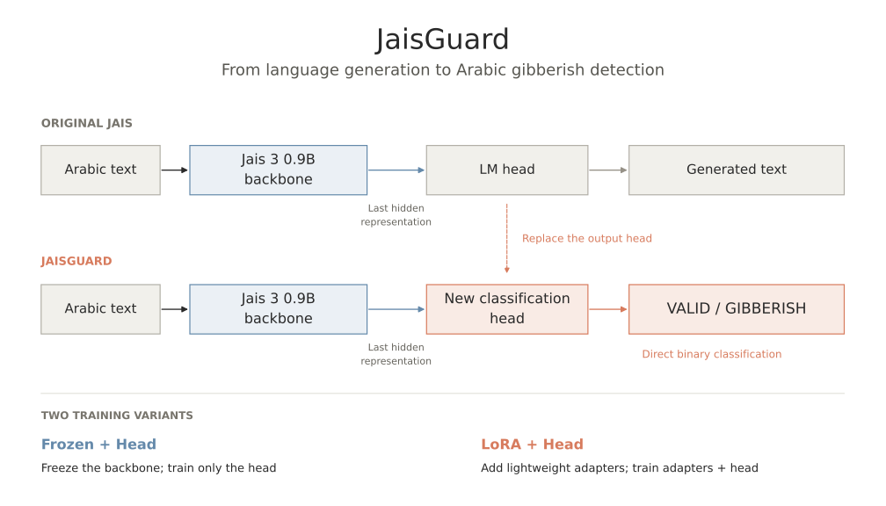
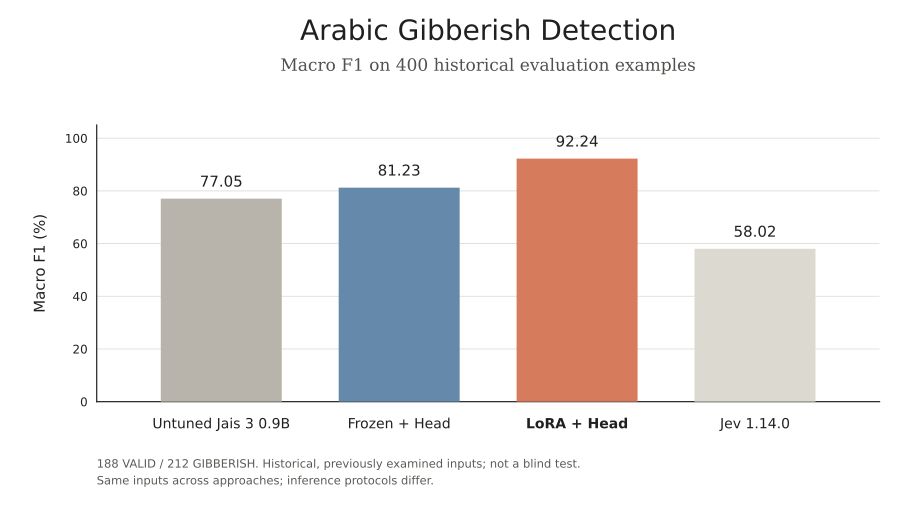
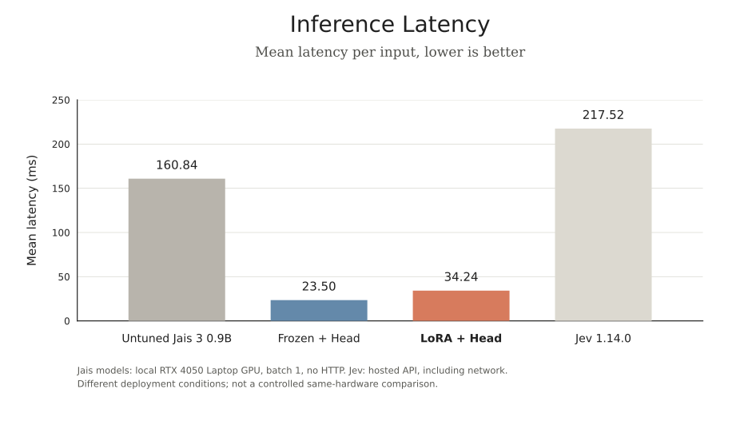

# JaisGuard

**Arabic Gibberish Detection with Jais 3 0.9B**

[](LICENSE)
[](https://huggingface.co/RayenFekih/JaisGuard-LoRA-0.9B)

**[LoRA model](https://huggingface.co/RayenFekih/JaisGuard-LoRA-0.9B)** ·
**[Frozen model](https://huggingface.co/RayenFekih/JaisGuard-Frozen-0.9B)** ·
**[Dataset](https://huggingface.co/datasets/RayenFekih/arabic-gibberish-detection)**

JaisGuard adapts a decoder-only Arabic language model into a binary **VALID / GIBBERISH**
classifier. It compares untuned Jais, frozen-backbone training, LoRA training and Jev,
measures classification and false-rejection trade-offs, and benchmarks GPU serving
with Hugging Face and vLLM.

- **Architecture adaptation:** replace vocabulary prediction with a pooled, FP32 classification head.
- **Measured quality:** published LoRA checkpoint reaches **92.25% accuracy / 92.24% macro F1**.
- **GPU inference:** historical vLLM export reaches **236.54 requests/s** at concurrency 16.

These are local research results on a previously examined, constructed benchmark;
quality and serving precision are reported separately below.

## From language generation to classification



JaisGuard **adapts the output architecture for classification**: it retains the
Jais 3 backbone and replaces the generative LM head with a new binary head.
The final non-padding hidden state feeds an FP32 `Linear(1536, 2)` layer and softmax;
a saved threshold on `P(GIBBERISH)` determines the label.

**Frozen + Head** trains only the 3,074-parameter head. **LoRA + Head** also trains
rank-8 adapters in `q_proj` / `v_proj` across all 28 layers. Both accept plain text
up to 64 tokens, without a chat wrapper or silent truncation.
See the [detailed transformer architecture](docs/architecture.md) and
[training methodology](docs/finetuning.md).

## Classification quality



All four methods use the **same 400 historical inputs**: 188 VALID and 212 GIBBERISH.
The trained rows are the published v2 checkpoints, selected by minimum validation
loss within each architecture, with validation-locked thresholds. They are
**individual checkpoints**, not averages or models selected by test performance.

| Approach | Accuracy | Macro F1 | VALID false rejection |
| --- | ---: | ---: | ---: |
| Untuned Jais 3 0.9B · zero-shot | 75.00% | 77.05% | 0.53% |
| Frozen Backbone + Head | 81.50% | 81.23% | 0.53% |
| **LoRA + Head** | **92.25%** | **92.24%** | **4.79%** |
| Jev 1.14.0 · hosted zero-shot | 62.25% | 58.02% | 0.00% |

Frozen and LoRA are **individual validation-selected v2 checkpoints**, evaluated
at their locked thresholds (0.9563547373 / 0.9429310560); quality uses BF16,
batch size 2. Untuned Jais uses its original generative prompt; Jev is hosted zero-shot.
Untuned Jais's 30 INVALID outputs count as wrong; false rejection counts explicit
GIBBERISH predictions only.

All methods use the same **400 constructed historical inputs** (188 VALID / 212
GIBBERISH). The test informed iteration two: this is **seen-benchmark regression
analysis**, not independent blind evaluation. See [full quality and protocol details](docs/benchmarks/quality-latency/comparison.md)
and [checkpoint metrics and experimental averages](docs/model-publication-preparation.md#metrics-individual-checkpoints-versus-experiments).

## Inference latency and GPU memory



**Mean latency per input**, over 400 inputs. Local inference uses an **RTX 4050
Laptop GPU (6 GB)**, batch 1, including tokenization and transfers, with three warmups
and no HTTP. Jev includes remote API/network overhead and no warmup; this is **not
a controlled same-hardware speed comparison**. Loading is excluded.
**Frozen is the fastest local approach** in the saved standalone benchmark.

| Local model | Peak allocated GPU memory |
| --- | ---: |
| Untuned Jais | 2,214.23 MiB |
| Frozen + Head | 1,997.45 MiB |
| LoRA + Head | 2,002.26 MiB |

Memory includes resident weights and measures the CUDA allocator peak, not total
board VRAM. Jev memory is unavailable. [Full standalone benchmark](docs/benchmarks/quality-latency/comparison.md).

**vLLM optimization.** Matched FP16 LoRA serving on the same GPU, with 400 warm
local HTTP requests per backend at concurrency 16, one input per request:

| Backend | Requests/s | Mean HTTP latency | Peak allocated GPU memory |
| --- | ---: | ---: | ---: |
| HF / FastAPI | 26.13 | 600.78 ms | 2,478.36 MiB |
| vLLM 0.32.0 | 236.54 | 67.34 ms | 4,515.01 MiB |

vLLM batches concurrent requests while HF serializes GPU work: **9.05× throughput**,
with higher VRAM use. See the [throughput figure and serving protocol](docs/vllm-serving.md#throughput-overview).

Under matched FP16 conditions, selected HF and vLLM classifiers produced **zero class
mismatches across 658 checked examples per model at both tested operating points**;
probabilities were close, not identical.

Native vLLM uses **separate historical full-backbone exports**, including merged
LoRA weights. The published compact Hugging Face packages use a custom loader and
**do not directly support native vLLM**. [Full serving measurements and precision limits](docs/benchmarks/vllm/comparison.md).

## Run the published LoRA model

Use **Python 3.11**, `uv`, and a CUDA GPU; the release was tested on the RTX 4050.
From this checkout, install the locked environment, then anonymously download the
verified model revision and run its bundled example:

```bash
uv sync --frozen --extra finetune
uv run --no-sync python - <<'PY'
from huggingface_hub import snapshot_download
snapshot_download(
    "RayenFekih/JaisGuard-LoRA-0.9B",
    revision="74977da942572cf15e0cbf6c815a343b1bd61af1",
    token=False, local_dir="downloads/JaisGuard-LoRA-0.9B",
)
PY
uv run --no-sync python downloads/JaisGuard-LoRA-0.9B/example.py \
  --local-files-only --text 'كيف يمكنني تعلم اللغة العربية؟'
```

This tested path requires the pinned **Jais base model already cached**, including
trusted upstream code, at revision `e51941b37091287fee4934e3f8a799e0d3fef37f`.
The original `IFM/Jais-3-0.9B` identifier redirects to `inception42/Jais-3-0.9B`.
For online base download, omit `--local-files-only`; that provisioning path was not
part of fresh-download GPU verification. The example returns probabilities and a
validation-locked label through the bundled `JaisGuardClassifier` custom API.

See [verified release and revisions](docs/model-publication-release.md), the
[Frozen model](https://huggingface.co/RayenFekih/JaisGuard-Frozen-0.9B), and
[training / serving workflows](docs/public-workflows.md). The compact packages require
their custom loader; standard Transformers sequence-classification auto-loading,
pipelines and Hugging Face Inference Providers are not supported.

## Dataset and reproducibility

The [dataset repository](https://huggingface.co/datasets/RayenFekih/arabic-gibberish-detection)
contains the prepared derivative: **1,498 train · 250 validation · 400 test = 2,148**.
Anonymous access returned HTTP 401 during README verification on 2026-10-31;
authorized access is currently required.

Published historical checkpoints trained on **1,500** examples. The derivative excludes
two training narratives for privacy uncertainty; validation and test are unchanged.
It therefore does **not** reproduce historical training exactly. Training includes
133 audited-provisional labels; benchmark construction, prior test inspection and
remaining privacy/memorization uncertainty limit interpretation. Numerical parity
is not privacy clearance. See [dataset provenance](docs/huggingface-public-release-v1.md),
[model limitations](docs/model-publication-preparation.md) and [reproducibility](docs/reproducibility.md).

## Further reading

| Topic | Documentation |
| --- | --- |
| Dataset construction and provenance | [Construction](docs/dataset.md) · [public derivative](docs/huggingface-public-release-v1.md) |
| Fine-tuning methodology | [Frozen and LoRA training](docs/finetuning.md) |
| Model comparisons and evaluation | [Version comparison](docs/version-comparison.md) · [quality evidence](docs/benchmarks/quality-latency/comparison.md) |
| HF and vLLM serving | [Public workflows](docs/public-workflows.md) · [vLLM](docs/vllm-serving.md) |
| Throughput, latency and memory | [Matched benchmarks](docs/benchmarks/vllm/comparison.md) · [FP16 protocol](docs/vllm-fp16-benchmark.md) |
| Reproducibility | [Artifact and replay boundaries](docs/reproducibility.md) · [figure sources](docs/assets/README.md) |
| Licensing | [MIT code](LICENSE) · [model terms](docs/model-publication-preparation.md#integrity-and-licensing-review) · [dataset terms](docs/huggingface-public-release-v1.md) |
