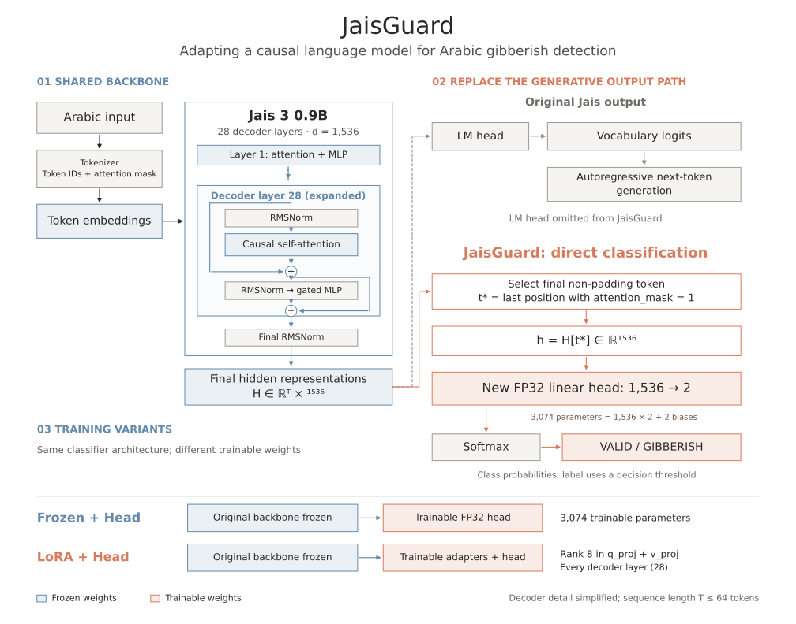

# JaisGuard architecture

The [README](../README.md) uses the simplified output-adaptation diagram.
This expanded figure documents the shared decoder backbone, pooling, FP32
classification head and two training variants.

The diagram expands one of 28 decoder layers and omits positional encoding and
attention-projection detail for readability. All original backbone parameters remain
frozen in both training variants; LoRA adds trainable q/v adapters alongside the head.
Pooling and softmax have no trainable parameters. At inference all weights are fixed.
Labels use a threshold on `P(GIBBERISH)`, rather than unconditional argmax.

See [supplied architecture notes and source references](assets/sources/architecture/architecture_notes.md),
[training implementation](../src/jais_guard/finetuning/model.py),
[methodology](finetuning.md), and [figure sources and regeneration](assets/README.md).
The preceding [README architecture figure](assets/architecture.svg) is also preserved.
